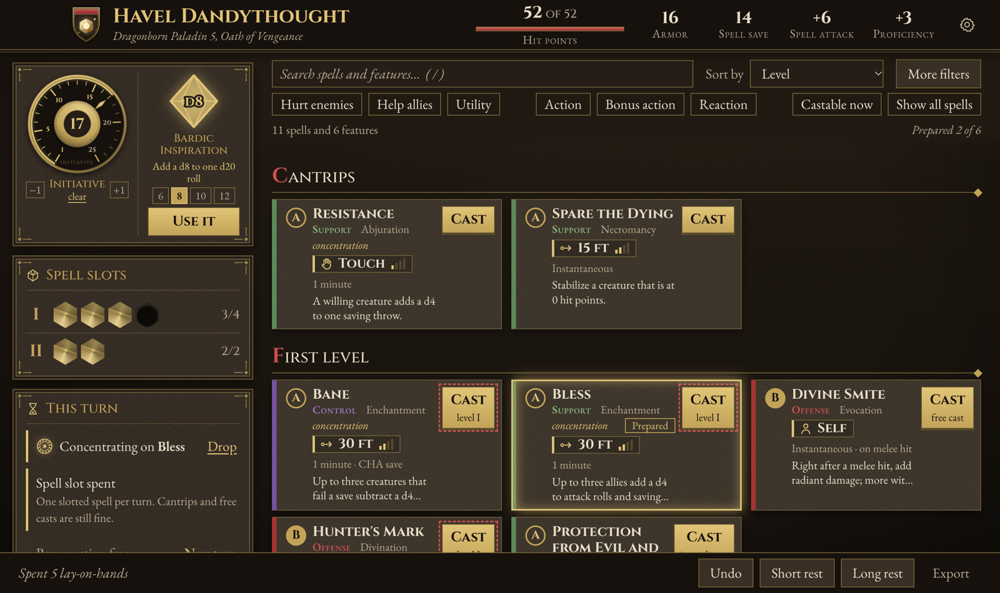

# Paladex

An offline spell, slot and resource tracker for a D&D 2024-rules Paladin, built with Electron, React and TypeScript.
It tracks spell slots, prepared spells, per-turn action economy, class resources, hit points, initiative, Bardic
Inspiration and rests, with undo.



*Mid-turn: initiative is set to 17 on the dial, Bardic Inspiration (a d8) is held, Bless is being concentrated on and a
level I slot is spent. Each spell card shows its range large, with a meter that fills with distance. Ideas for what comes
next are in [ROADMAP.md](ROADMAP.md).*

## Finding spells

The bar above the spell cards has three rows: search, sort and a filter panel; quick filters; and a line saying what is
showing ("11 spells and 6 features").

- **Search** (press `/` to jump to it, Esc clears it). Every word must appear somewhere in the spell, in any order: its name,
  summary, full description, school, range, duration, role, casting time, level and source. Apostrophes and case do not
  matter ("hunters mark" finds Hunter's Mark). A card that matched only through text it doesn't show says "Found in the
  full text". Search also reaches class features and the Other features list.
- **Sort by** Level (the default), Name, Range (nearest first), Casting time, School or What it does. The headings follow the
  sort, so under Range the cards sit under Self, Touch, Up to 30 ft, 31 to 60 ft and Over 60 ft.
- **Quick filters**: Hurt enemies / Help allies / Utility, Action / Bonus action / Reaction, Castable now, and Show all
  spells (to prepare spells you haven't chosen).
- **More filters**: Level, Range, School, Save or attack, Source, Ritual only and No concentration. Within a group any chosen
  value matches; across groups all must. What you pick shows as removable chips under the bar, and the button carries a
  count. These describe spells, so class features are hidden while any is on.
- When filters hide spells you haven't prepared, the status line offers them ("2 more matches among unprepared spells").

Every spell card shows its **range** large, with an icon (you, a hand, an arrow), the distance, any area ("Self, 30 ft
area") and a meter that fills with distance. Filters, search and sort are view settings: they are not saved and not undoable.

## At the table

The top of the left rail holds two things you carry from the table into your own turn. Both are saved with the character.

- **Initiative dial.** Turn the brass knob to a number from 1 to 25: drag it, click the scale, use the arrow keys (Page
  Up/Down step by five, Home/End jump to the ends), press −1/+1, or just type the number. Backspace or "clear" resets it. A
  rest does not clear it.
- **Bardic Inspiration.** A die (d6, d8, d10 or d12; a d8 to begin with) that glows while you hold it. Press Receive when a
  Bard gives it to you, pick the size they gave, and press Use it when you spend it. Any rest ends it, since it only lasts
  an hour. The die size is remembered, and every step is logged and undoable.

## Getting started

```bash
npm install
npm run dev          # run the app with hot reload
npm test             # vitest
npm run typecheck    # node, web and test tsconfigs
```

| Script | What it does |
| --- | --- |
| `npm run seed` | Rebuilds `data/havel.character.json` from the raw D&D Beyond export in `data/raw/` (gitignored) |
| `npm run build:app` | Builds an unpacked macOS app into `dist/` |
| `npm run install-app` | Builds and installs to `/Applications` (flags: `--no-build`, `--dir`, `--open`, `--dry-run`) |
| `npm run icon` | Regenerates the app icon from `build/icon.svg` |

## Settings and color themes

Open settings with the gear button in the top bar, or **Cmd+,** (Ctrl+, elsewhere). **Esc** or "Back to sheet" returns.
Each theme is previewed as a miniature of the sheet, and choosing one applies instantly and is remembered.

| Theme | Character |
| --- | --- |
| Candlelit Oak | Warm dark wood and gold leaf (the default) |
| Moonlit Steel | Cool slate with a silver accent |
| Elven Glade | Deep forest green with leaf-gold trim |
| Ember Court | Burgundy and banked coals, copper accent |
| Parchment & Ink | The one light theme, for bright rooms |
| High Contrast | Black and white with a bold yellow accent |

The choice is a view preference, stored in the renderer's `localStorage` (key `paladex.theme`). It is separate from the
play state, so it is never undone, logged or exported. A tiny blocking script, `src/renderer/public/theme-boot.js`, applies
it before the first paint so there is no flash of the default theme on launch.

### Adding a theme

1. Add a `[data-theme='your-id']` block to `src/renderer/styles/themes.css`. Copy an existing block and change the
   values; every palette token must be present, as plain hex literals. Set `color-scheme: dark` or `light` in the block.
2. Add `{ id, name, blurb }` to `THEMES` in `src/renderer/domain/themes.ts`.
3. Run `npm test`. `domain/themes.test.ts` checks that the registry and CSS agree (no missing or orphaned blocks) and
   enforces WCAG AA contrast (4.5:1) on every text pair of every palette.

The settings preview needs no extra work: it wears the theme through `data-theme`, so it always matches the real UI.

## Window and layout

The window reopens where you left it: size, position, maximized and full-screen state are saved to `window-state.json` in the
profile folder (next to the `state/` folder, but never part of the play state, so a reset leaves it alone). If the saved monitor is
gone the window opens centred on the main display, and a frame larger than the screen is fitted to it. Minimum size is 960x560.

Every page fills the window. The rail, detail drawer and card columns grow with the width (`--rail-width`, `--drawer-width`,
`--card-min` in `tokens.css`), so a wide window shows more cards per row and the settings page uses the full width.

## Motion and ornament

Candle-flicker light and vignette behind the page, gilt corner studs on panels, heading lozenges, gems that kindle and glint,
a pulsing frame and turning rune ring while concentrating, a ring of light on Cast, a heartbeat on the HP bar at 25% or less,
and a wash of light on short and long rests. It is all CSS and inline SVG (no assets, no JS animation), tinted by the active
theme, and switched off entirely by the system's "reduce motion" setting.

## Where things live

```
src/main/       Electron main process: window, menu, IPC, atomic JSON store with backup
src/preload/    The `window.paladex` bridge
src/shared/     Types, zod schema and constants shared by every process
src/renderer/
  domain/       Pure game logic (slots, rests, turns, filters, themes) with colocated tests
  state/        zustand stores: play state (persisted), UI state (not persisted), theme (localStorage)
  components/   React components
  styles/       tokens.css (default palette, token contract, shared tokens), themes.css (other palettes), app.css
  public/       theme-boot.js, the pre-paint theme script (static, copied as-is)
scripts/        Seeding, icon and install tooling
data/           Seeded character JSON
```

Play state is saved to `~/Library/Application Support/Paladex`. Set `PALADEX_USER_DATA=<dir>` to use a throwaway
profile when testing; this matters because Electron ignores `$HOME` on macOS.
